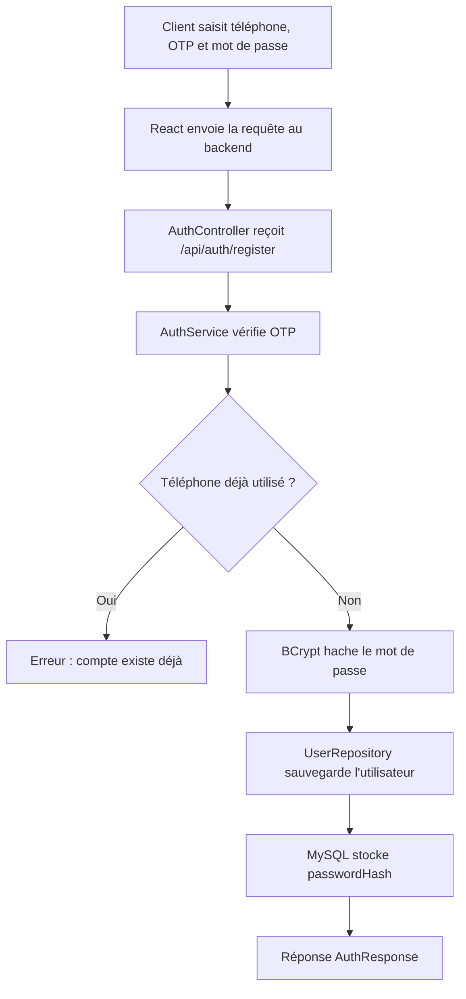
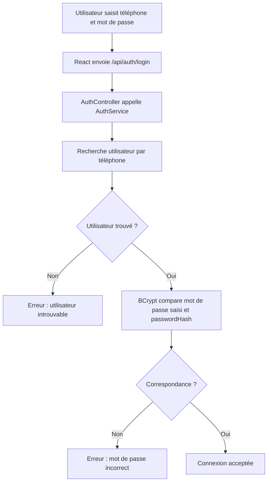
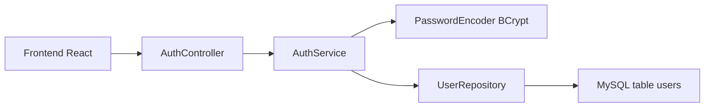
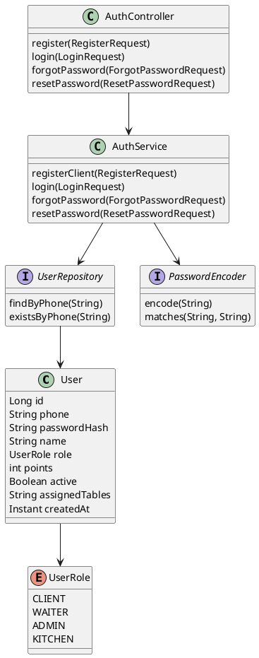

# Rapport de projet : Hachage de mots de passe dans POS2 Restaurant

## Page de garde

**Projet :** Hachage de mots de passe  
**Application support :** POS2 Restaurant  
**Technologies :** React, Vite, Spring Boot, MySQL  
**Module étudié :** Authentification client, serveur et administrateur  
**Réalisé par :** ........................................  
**Encadré par :** ........................................  
**Année universitaire :** 2025 / 2026

---

## 1. Description claire du projet

### 1.1 Contexte général

Le projet POS2 Restaurant est une application web de gestion de restaurant. Elle permet au client de consulter le menu à partir d'un QR code, de passer une commande depuis son téléphone, puis au serveur de valider cette commande avant son passage en cuisine. L'application contient aussi une interface serveur, une interface cuisine et une interface administrateur.

Dans ce type de système, plusieurs utilisateurs doivent se connecter :

- le client, pour garder son historique et ses points de fidélité ;
- le serveur, pour gérer les commandes et les paiements ;
- l'administrateur, pour gérer le menu, les tables, les comptes et les paramètres du restaurant.

Ces utilisateurs utilisent un numéro de téléphone et un mot de passe. Le mot de passe est donc une donnée sensible qui doit être protégée.

### 1.2 Problématique

Un problème important dans les applications web est le stockage des mots de passe. Si une application stocke les mots de passe en clair dans la base de données, une fuite de données peut exposer directement les comptes des utilisateurs.

Exemple dangereux :

| phone | password |
|---|---|
| 0600000000 | 1234 |
| 0611111111 | client123 |

Dans ce cas, une personne qui accède à la base de données connaît immédiatement les mots de passe.

La question principale est donc :

**Comment protéger les mots de passe des utilisateurs dans une application POS restaurant, tout en gardant une authentification simple et utilisable ?**

### 1.3 Objectif du projet

L'objectif de ce travail est d'implémenter et d'expliquer le hachage de mots de passe dans le backend de POS2.

Le projet vise à :

- comprendre le rôle d'une fonction de hachage ;
- expliquer le principe de SHA-256 ;
- montrer pourquoi SHA-256 seul n'est pas idéal pour les mots de passe ;
- utiliser BCrypt comme solution plus adaptée ;
- stocker uniquement un hash dans MySQL ;
- vérifier le mot de passe lors de la connexion sans jamais le stocker en clair.

---

## 2. Notions théoriques

### 2.1 Qu'est-ce que le hachage ?

Le hachage est une opération qui transforme une donnée en une empreinte numérique appelée **hash**. Cette empreinte a une taille fixe et ne permet pas normalement de retrouver le texte original.

Exemple simplifié :

```text
Mot de passe : 1234
        ↓
Fonction de hachage
        ↓
Hash : 03ac674216f3e15c...
```

Le hachage est différent du chiffrement. Le chiffrement peut être inversé avec une clé, alors que le hachage est conçu pour être non réversible.

### 2.2 Rôle de SHA-256

SHA-256 est une fonction de hachage cryptographique. Elle transforme une donnée en une empreinte de 256 bits.

Elle est utilisée dans plusieurs domaines :

- vérification d'intégrité de fichiers ;
- signatures numériques ;
- blockchain ;
- comparaison d'empreintes.

Exemple avec SHA-256 :

```text
SHA-256("1234")
= 03ac674216f3e15c761ee1a5e255f067953623c8b388b4459e13f978d7c846f4
```

Cependant, pour les mots de passe, SHA-256 seul est insuffisant, car il est rapide. Un attaquant peut tester des millions de mots de passe par seconde avec des dictionnaires ou des attaques brute force.

### 2.3 Pourquoi utiliser BCrypt ?

BCrypt est plus adapté au stockage de mots de passe, car :

- il ajoute un sel automatiquement ;
- il ralentit volontairement le calcul ;
- deux utilisateurs avec le même mot de passe n'auront pas le même hash ;
- il est conçu spécialement pour les mots de passe.

Exemple :

```text
Mot de passe : 1234
Hash BCrypt : $2a$10$7fNn...Vj3x
```

Le hash BCrypt change à chaque encodage grâce au sel. Cela rend les attaques beaucoup plus difficiles.

Dans POS2, SHA-256 est donc présenté comme une base théorique, mais l'implémentation réelle utilise BCrypt.

---

## 3. Méthodologie de réalisation

### 3.1 Approche adoptée

Le module de sécurité est intégré au backend Spring Boot de POS2. L'utilisateur saisit son numéro de téléphone et son mot de passe depuis l'interface React. Le backend reçoit ces informations, puis applique un traitement différent selon l'action :

- inscription : le mot de passe est haché avant stockage ;
- connexion : le mot de passe saisi est comparé avec le hash stocké ;
- mot de passe oublié : un OTP simulé permet de définir un nouveau mot de passe ;
- changement de mot de passe : le nouveau mot de passe est également haché.

### 3.2 Technologies utilisées

| Technologie | Rôle |
|---|---|
| React + Vite | Interface utilisateur |
| Spring Boot | Backend et logique métier |
| MySQL | Stockage des utilisateurs |
| BCrypt | Hachage sécurisé des mots de passe |
| JPA / Hibernate | Mapping entre Java et MySQL |
| Postman | Test des endpoints |
| Mermaid / PlantUML | Schémas explicatifs |

### 3.3 Architecture du module

Le module respecte une architecture en couches :

```text
React
  ↓
AuthController
  ↓
AuthService
  ↓
UserRepository
  ↓
MySQL
```

Chaque couche a un rôle précis :

- **Controller** : reçoit les requêtes HTTP ;
- **Service** : contient la logique métier ;
- **Repository** : communique avec la base de données ;
- **Entity** : représente la table `users`.

---

## 4. Implémentation dans POS2

### 4.1 Entité User

L'entité `User` représente les utilisateurs du système. Elle contient un champ `passwordHash`, et non pas un champ `password`.

Fichier :

```text
backend/src/main/java/com/pos2/restaurant/domain/User.java
```

Champs principaux :

```text
id
phone
passwordHash
name
role
points
active
assignedTables
createdAt
```

Le champ important est :

```java
private String passwordHash;
```

Cela signifie que le mot de passe en clair n'est pas stocké.

### 4.2 Configuration BCrypt

Le projet déclare un `PasswordEncoder` basé sur BCrypt.

Fichier :

```text
backend/src/main/java/com/pos2/restaurant/config/PasswordConfig.java
```

Code utilisé :

```java
@Configuration
public class PasswordConfig {

    @Bean
    public PasswordEncoder passwordEncoder() {
        return new BCryptPasswordEncoder();
    }
}
```

Ce bean est ensuite injecté dans `AuthService`.

### 4.3 Inscription d'un client

Lorsqu'un client crée un compte, il saisit :

- son numéro de téléphone ;
- un code OTP simulé ;
- son nom ;
- son mot de passe.

Fichier DTO :

```text
backend/src/main/java/com/pos2/restaurant/dto/auth/RegisterRequest.java
```

Le backend vérifie le code OTP, puis encode le mot de passe :

```java
passwordEncoder.encode(request.password())
```

Le hash est ensuite stocké dans la base :

```java
User user = new User(
        request.phone(),
        passwordEncoder.encode(request.password()),
        request.name(),
        UserRole.CLIENT
);
```

### 4.4 Connexion d'un utilisateur

Lors de la connexion, le backend récupère l'utilisateur par téléphone. Ensuite il compare le mot de passe saisi avec le hash stocké.

Fichier :

```text
backend/src/main/java/com/pos2/restaurant/service/AuthService.java
```

Code principal :

```java
if (!passwordEncoder.matches(request.password(), user.getPasswordHash())) {
    throw new BadRequestException("Mot de passe incorrect.");
}
```

Le mot de passe saisi n'est pas stocké. Il sert uniquement à vérifier s'il correspond au hash existant.

### 4.5 Réinitialisation du mot de passe

Le projet contient aussi un système simple de mot de passe oublié :

- l'utilisateur saisit son téléphone ;
- le backend simule l'envoi du code OTP `1234` ;
- l'utilisateur saisit un nouveau mot de passe ;
- le backend hache le nouveau mot de passe avant de le sauvegarder.

Code :

```java
user.setPasswordHash(passwordEncoder.encode(request.newPassword()));
```

Cela garantit que même après réinitialisation, le mot de passe n'est jamais stocké en clair.

---

## 5. Endpoints utilisés

### 5.1 Inscription

```http
POST /api/auth/register
```

Exemple de requête :

```json
{
  "phone": "0611111111",
  "otp": "1234",
  "password": "1234",
  "name": "youssef"
}
```

Résultat attendu :

```json
{
  "userId": 1,
  "phone": "0611111111",
  "name": "youssef",
  "role": "CLIENT",
  "points": 0,
  "assignedTables": null
}
```

### 5.2 Connexion

```http
POST /api/auth/login
```

Exemple :

```json
{
  "phone": "0611111111",
  "password": "1234"
}
```

### 5.3 Mot de passe oublié

```http
POST /api/auth/forgot-password
```

Exemple :

```json
{
  "phone": "0611111111"
}
```

Résultat :

```json
{
  "message": "Code envoye : 1234"
}
```

### 5.4 Réinitialisation

```http
POST /api/auth/reset-password
```

Exemple :

```json
{
  "phone": "0611111111",
  "otp": "1234",
  "newPassword": "5678"
}
```

---

## 6. Schémas explicatifs

### 6.1 Schéma du processus d'inscription



### 6.2 Schéma du processus de connexion



### 6.3 Diagramme de composants



### 6.4 Diagramme de classes simplifié



---

## 7. Captures d'écran à insérer

Les captures suivantes sont recommandées pour rendre le rapport personnel et concret.

### Capture 1 : Interface de connexion client

Insérer une capture de la page où le client saisit son téléphone et son mot de passe.

```text
Exemple de nom : docs/screenshots/01-connexion-client.png
```

### Capture 2 : Interface d'inscription avec OTP

Montrer le formulaire d'inscription avec le code OTP simulé `1234`.

```text
Exemple de nom : docs/screenshots/02-inscription-otp.png
```

### Capture 3 : Test Postman de l'inscription

Montrer la requête :

```http
POST http://localhost:8080/api/auth/register
```

### Capture 4 : Base de données MySQL

Montrer la table `users`, surtout la colonne `password_hash`.

Le résultat attendu est que le mot de passe ne soit pas visible en clair.

Exemple :

| phone | password_hash |
|---|---|
| 0611111111 | $2a$10$... |

### Capture 5 : Test Postman de connexion

Montrer :

```http
POST http://localhost:8080/api/auth/login
```

Avec une connexion réussie.

### Capture 6 : Mot de passe oublié

Montrer la requête de récupération :

```http
POST /api/auth/forgot-password
```

Puis :

```http
POST /api/auth/reset-password
```

---

## 8. Résultats attendus

À la fin de l'implémentation, le système doit respecter les résultats suivants :

1. Le mot de passe n'est jamais stocké en clair.
2. Le champ `passwordHash` contient uniquement une empreinte BCrypt.
3. Deux mots de passe identiques peuvent produire deux hashes différents.
4. La connexion fonctionne avec le mot de passe original.
5. Un mot de passe incorrect est refusé.
6. La réinitialisation du mot de passe remplace l'ancien hash par un nouveau.
7. La base de données reste plus sécurisée en cas de fuite.

---

## 9. Tests réalisés

### 9.1 Test d'inscription

**Objectif :** vérifier que le backend crée un utilisateur avec un mot de passe haché.

Étapes :

1. Envoyer une requête `POST /api/auth/register`.
2. Vérifier la réponse JSON.
3. Ouvrir MySQL.
4. Vérifier que `password_hash` ne contient pas le mot de passe en clair.

Résultat attendu :

```text
Le compte est créé et le mot de passe est haché.
```

### 9.2 Test de connexion correcte

**Objectif :** vérifier que l'utilisateur peut se connecter avec son vrai mot de passe.

Étapes :

1. Envoyer `POST /api/auth/login`.
2. Utiliser le téléphone et le mot de passe corrects.
3. Vérifier que le backend retourne les informations de l'utilisateur.

Résultat attendu :

```text
Connexion réussie.
```

### 9.3 Test de connexion incorrecte

**Objectif :** vérifier qu'un mauvais mot de passe est refusé.

Étapes :

1. Envoyer `POST /api/auth/login`.
2. Utiliser un mauvais mot de passe.

Résultat attendu :

```text
Erreur : Mot de passe incorrect.
```

### 9.4 Test de réinitialisation

**Objectif :** vérifier que le nouveau mot de passe est aussi haché.

Étapes :

1. Appeler `/api/auth/forgot-password`.
2. Utiliser l'OTP `1234`.
3. Appeler `/api/auth/reset-password`.
4. Vérifier dans MySQL que le hash a changé.

Résultat attendu :

```text
Le mot de passe est modifié et stocké sous forme hachée.
```

---

## 10. Discussion : SHA-256 ou BCrypt ?

SHA-256 est une fonction de hachage importante et fiable pour plusieurs usages. Elle permet d'expliquer le principe du hachage, car elle transforme une donnée en empreinte fixe.

Cependant, dans le cas des mots de passe, SHA-256 seul est trop rapide. Un attaquant peut tester beaucoup de combinaisons rapidement.

BCrypt est plus adapté, car il est volontairement plus lent et utilise un sel. Pour cette raison, POS2 utilise BCrypt dans l'implémentation réelle.

Comparaison :

| Critère | SHA-256 | BCrypt |
|---|---|---|
| Fonction de hachage | Oui | Oui |
| Adapté aux mots de passe | Moyen seul | Oui |
| Sel automatique | Non | Oui |
| Résistance brute force | Faible si utilisé seul | Meilleure |
| Utilisation dans POS2 | Explication théorique | Implémentation réelle |

---

## 11. Limites du travail

Le module actuel est adapté pour une démonstration académique. Cependant, pour une version totalement professionnelle, il faudrait ajouter :

- politique de mot de passe plus stricte ;
- limitation du nombre de tentatives de connexion ;
- journalisation des connexions suspectes ;
- envoi réel de l'OTP par SMS ;
- protection complète par session ou JWT selon le déploiement ;
- configuration sécurisée des secrets backend.

Ces améliorations peuvent être ajoutées dans une prochaine version du projet.

---

## 12. Conclusion

Ce travail a permis d'intégrer un mécanisme de hachage de mots de passe dans le système POS2 Restaurant. Le projet montre l'importance de ne jamais stocker les mots de passe en clair dans une base de données.

SHA-256 permet de comprendre le principe du hachage, mais BCrypt est plus adapté pour les mots de passe réels. Dans POS2, le backend Spring Boot utilise donc `BCryptPasswordEncoder` pour hacher les mots de passe lors de l'inscription et lors de la réinitialisation.

Grâce à ce module, les comptes clients, serveurs et administrateurs sont mieux protégés. Le projet devient ainsi plus réaliste, plus professionnel et plus proche des exigences d'une application web moderne.

---

## Annexes

### A. Fichiers principaux du projet

| Fichier | Rôle |
|---|---|
| `User.java` | Entité utilisateur |
| `UserRole.java` | Rôles utilisateur |
| `UserRepository.java` | Accès aux utilisateurs |
| `AuthController.java` | Endpoints d'authentification |
| `AuthService.java` | Logique de hachage et connexion |
| `PasswordConfig.java` | Configuration BCrypt |
| `RegisterRequest.java` | DTO inscription |
| `LoginRequest.java` | DTO connexion |
| `ResetPasswordRequest.java` | DTO réinitialisation |

### B. Exemple de hash BCrypt

```text
$2a$10$Q2Z2nB6RDNm8zI2jq2ZLNeKfSxqf29bEGxP7CkM5C1QjYyLxE1lG.
```

Ce texte ne permet pas de retrouver directement le mot de passe original.

